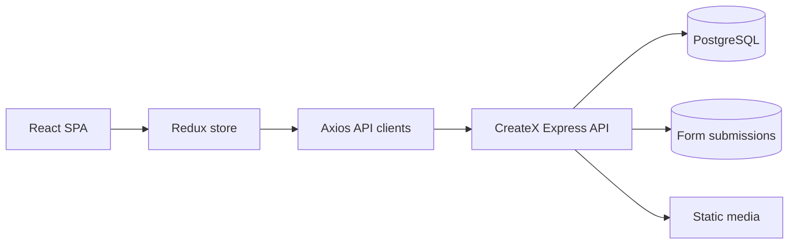

# CreateX Online School

[](https://github.com/Kotyarya/CreateX/actions/workflows/ci.yml)

Responsive React frontend for a full-stack online-school demo. Visitors can browse courses, events and articles, filter catalogues, open detail pages, submit contact/registration forms, and create or access a demo account.

**Live demo:** [createx-maksym-aksamitnyi.vercel.app](https://createx-maksym-aksamitnyi.vercel.app)

**Production API:** [createx-server-maksym.onrender.com/api/health](https://createx-server-maksym.onrender.com/api/health)

## Stack

- React 18, TypeScript and Vite
- Redux + Redux Thunk
- React Router
- React Hook Form
- SCSS modules
- Vitest and Testing Library

The API lives in [Kotyarya/CreateX-SERVER](https://github.com/Kotyarya/CreateX-SERVER). The frontend expects that service at `http://localhost:8000/api` by default.

## Local setup

Requirements: Node.js 24 and npm.

```bash
git clone https://github.com/Kotyarya/CreateX.git
cd CreateX
cp .env.example .env.local
npm ci --legacy-peer-deps
npm run dev
```

Open [http://localhost:3000](http://localhost:3000).

Environment variables:

| Variable | Purpose |
| --- | --- |
| `VITE_API_URL` | REST API base URL, including `/api` |
| `VITE_ASSET_URL` | Backend base URL used for uploaded images and audio |

## Quality checks

```bash
npm run lint
npm test
npm run build
npm audit --omit=dev
```

GitHub Actions runs the same checks on every pull request and push to `main`.

## Main flows

- course catalogue, category filtering, search and course details;
- events catalogue and event details;
- blog catalogue and article/podcast/video details;
- contact, course/event registration and newsletter forms;
- account registration and login.

## Architecture



The repository root is the deployable application root. For static hosting, publish `dist/` and route unknown paths to `index.html`.
